# Lumen — World Trends

一个**纯客户端、无服务端的双语热点台**：持续抓取全球热点新闻，用**事件图谱**表达世界元素间的关系，用**趋势引擎**量化话题的变动，用 **AI 因果解读**讲清“世界为什么在变”，全部数据**本地缓存、可离线回看/检索**。

> 名字 *Lumen* 取意“光”，寓意照亮世界趋势。

---

## ✨ 特性

- **双语聚合**：内置五路 RSS（BBC World / The Guardian World / NYT World / 36氪 / IT之家），中英双语；界面支持一键中/英切换。
- **中文热点源**（M23）：6 路自动采集——微博热搜 / 知乎热榜 / 头条热榜 / 百度热搜 / B站热门 / 抖音热门；引入 `json-api` 与 `browser`（复用 Electron BrowserWindow）两种新适配器，热度数值结构化入 `article.hot_score`。
- **热度排序 UI**（M24）：trends / dashboard / world 三视图消费 `article.hot_score`；trends 可切 24h/7d/30d/all + 4 种显示风格；dashboard 顶部「今日热点 Top 10」；world 国家详情「该国今日热点 5 条」。
- **事件图谱**：实体抽取（词典 gazetteer）→ 共现关系 → 共享实体聚类成事件，落库为 entity / event / edge。
- **趋势引擎**：按时间桶计算话题热度序列、动量（涨/跌）、世界热点（国家维度）。
- **AI 因果解读**：对最热话题生成中文因果解读；provider 可插拔（火山方舟 ARK / Mock）。
- **多智能体趋势判断**（智能体 Tab）：取证 → 多空 N 轮辩论 → 裁决 → 三方风控 → 观察方案 → 人工审批 → 记忆结算；节点级事件流（`node.started` / `node.token` / `node.completed` 等）、四态流程图、条件边与角色 prompt 可编辑、sql.js checkpoint 断点续跑；无 Key 时自动走离线 Mock，配置 `ARK_API_KEY` 即切真实模型。
- **因果链**：输入任意实体，把其相关事件按时间串成链路（共享实体作锚点），可选 AI 逐段补因果断言 + 整体摘要。
- **全局叙事**：把跨实体的因果链按共享事件自动合并成更大的叙事（如“制裁 China → 油价 Oil → 通胀 US”），从局部链到世界叙事一张图；支持一键 **AI 整体摘要** 与 **反事实推演**（“如果首个事件没有发生会怎样”）。
- **解读中心体验**：AI 解读 / 因果链双栏布局；新手三步引导（采集→建图→生成）；一键导出 Markdown/JSON 快照。
- **桌面看板**：9 个 Tab（总览 / 时间线 / 图谱 / 解读 / 趋势 / 世界 / 股票 / 检索 / 智能体）。
- **总览数据**：文章/实体/事件/关系边/今日新增指标卡 + 今日热点 + 调度状态（`dashboard:today`）。
- **AI 解读中心**：因果解读 + 周报生成 + 实体因果链，历史本地缓存。
- **时间线回放**：把聚类出的事件按时间倒序组织成可回看的时间线，附其关联文章。
- **事件图谱可视化**：以力导向图展示实体节点与共现边，可开/关事件节点（菱形）+ 事件→实体边，可拖拽、滚轮缩放。
- **自动调度**：冷启动即自行跑一轮「采集→图谱→趋势」，此后每 30 分钟自动刷新（`LUMEN_INTERVAL_MINUTES` 可调）。
- **双语界面**：中文/English 一键切换，选择本地记忆（`src/i18n/`，零新依赖）。
- **世界热力地图**：世界 GeoJSON choropleth（110m），国家热度着色、可缩放拖动，点击区域联动国家详情/对比。
- **世界按日回放**：把最近 14 天按「每篇文章的日期」拆成日级热度，地图可播放/暂停/拖动时间轴回看世界热度的逐日演变。
- **大洲聚合视图**：世界 Tab 「国家 / 大洲」双维度一键切换；大洲模式地图按所在洲总热度着色、榜单改显洲级热度，回放同样支持洲级逐日演变（`src/world/regions.ts`，8 洲静态映射，零依赖）。
- **股票行情 Tab**：指数/A股/港股/美股约 33 个内置标的 + **自选股可增删**（输入市场前缀代码，如 `usAAPL`/`hk00700`，添加前经行情接口校验；腾讯公开行情 qt.gtimg.cn + ifzq.gtimg.cn，无需 API Key），报价表 + ECharts K 线（**日K/周K/月K**、红涨绿跌、可缩放），**每 5 分钟自动刷新**（`STOCK_REFRESH_MINUTES` 可调）与本地缓存离线可看上次行情。
- **股票增强**（M22）：自选股**分组**（默认/可新增/重命名/删除，行内 chip 操作；不可删默认/最后剩 1 组保护）、**多种排序**（默认 / 名称 / 最新价 / 涨跌额 / 涨跌幅一键切换）、**财务指标**列（PE / PB / 总市值 / 换手率 / 振幅 / 量比，按钮一键显隐）、**价格预警**（每行 🔔：涨破 / 跌破 价位，或涨跌幅超过阈值；命中触发系统通知；同日去重避免刷屏；`stock_alert` 表 + `scanAlerts` 纯函数扫描 + Electron `Notification` 触发）。
- **市场×趋势联动**：趋势 Tab「大盘与热点联动」把指数收盘价（右轴）叠加到 Top 热点热度（左轴）同一时间轴（缺失交易日断线）；世界 Tab「全球市场冷暖」展示上证/恒生/纳指等 9 大指数当日涨跌（红涨绿跌）——全部由本地行情缓存驱动。
- **本地缓存**：SQLite 落盘（`sql.js`），采集/建图/解读后与退出前自动持久化，离线可回看/检索。
- **无服务端**：主进程 Node 完成采集/图谱/趋势/AI，渲染层仅展示；二者只走 Electron IPC，不监听任何端口。
- **采集策略（UI 可配）**：总览 Tab 可勾选启用的新闻源、开关自动调度、调间隔（1-720 分钟），保存后即时生效并落库持久化（`settings:get` / `settings:update`）。

## 截图一览

下面 12 张截图按 9 个 Tab 的顺序展示 Lumen 看板的真实使用效果。

### 总览 Tab — 指标卡 + 引擎状态 + 采集策略

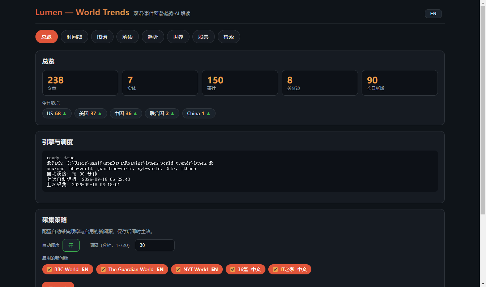

仪表盘入口：5 张核心指标卡（文章 / 实体 / 事件 / 关系边 / 今日新增）+ 今日热点 chips + **M24 今日热点 Top 10 卡片（24h / 🔥 风格）** + 引擎调度状态（`ready`/`dbPath`/`sources`/`自动调度`/`上次/下次自动运行`）+ **采集策略** UI（启用的新闻源勾选 + 自动调度开关 + 间隔分钟 1–720，保存即生效）。点「手动采集 / 构建图谱」即可触发 `collector:manualRun` / `graph:build`。

### 趋势 Tab — Top5 话题热度 + 大盘与热点联动

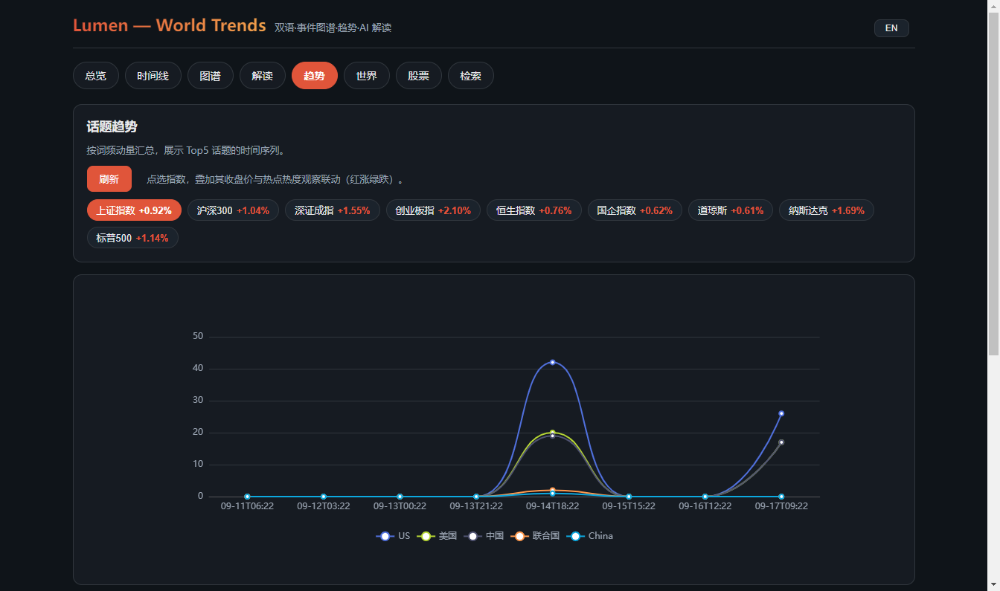

顶部 chip 列出 9 大指数当日涨跌（红涨绿跌）；点选指数后 ECharts 把「指数收盘价」叠加到 Top5 话题热度同一时间轴上（双 Y 轴，缺失交易日断线），把"市场冷暖"与"舆论热度"一眼对位。

**M24 热度分支**：顶部可切「按时间 / 按热度」+ 24h/7d/30d/all 时间窗 + A/B/C/D 四种显示风格（默认 B 紧凑单位）。

### 世界 Tab — 国家/大洲双维度 + 按日回放 + 全球市场冷暖

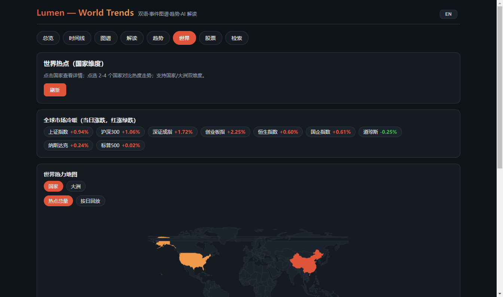

Choropleth 热力地图按国家（或大洲）热度着色，左上「国家 / 大洲」一键切换；顶部是 9 大指数当日涨跌条（**全球市场冷暖**）；支持**按日回放**最近 14 天的世界热度演变，可播放/暂停/拖时间轴。点击国家出下拉集显国家详情与 2-4 国对比折线。

**M24 该国今日热点 5 条**（24h / 紧凑风格）：点选国家后详情区顶部显示该国 24h 内最热的 5 条文章（0 结果时区块自动隐藏）。

### 股票 Tab — 自选股报价 + 日/周/月 K 线

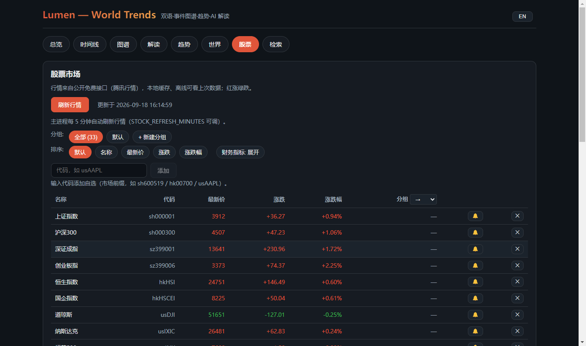

报价表：名称 / 代码 / 最新价 / 涨跌 / 涨跌幅（红涨绿跌）；可输入市场前缀代码（如 `usAAPL` / `hk00700` / `sh600519`）**校验后增删**自选股；点击行打开 **ECharts K 线**（日K / 周K / 月K 切换 + 成交量副图 + 滚轮缩放）。主进程每 5 分钟自动刷新（`STOCK_REFRESH_MINUTES` 可调），本地缓存保证离线仍能看上次行情。

### 解读 Tab — AI 解读中心 + 全局叙事

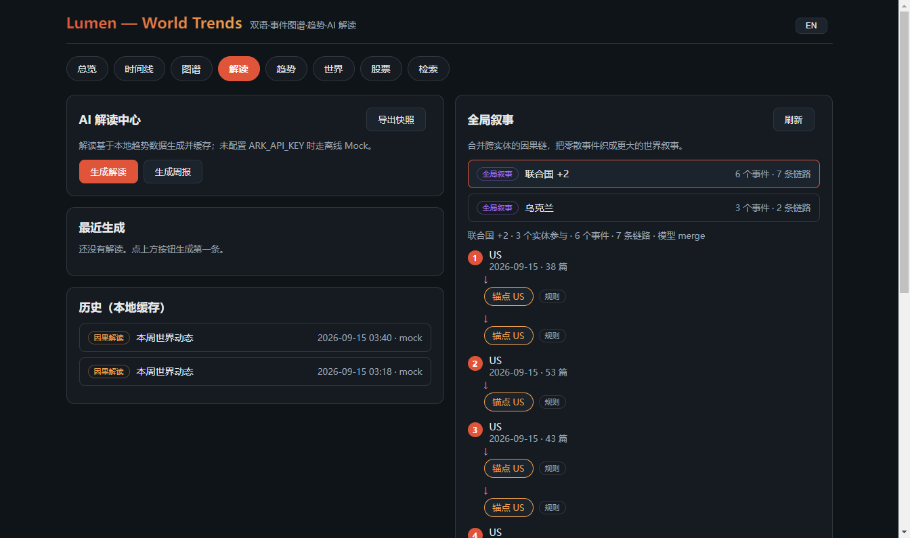

左栏 **AI 解读中心**：一键「生成解读 / 生成周报」+ 历史本地缓存，未配置 `ARK_API_KEY` 自动走离线 Mock；右栏 **全局叙事**：自动合并跨实体因果链，把零散事件组织成更大的世界叙事（如"制裁 China → 油价 Oil → 通胀 US"），并支持一键 AI 摘要 / 反事实推演。

### 时间线 Tab — 事件按时间倒序回看

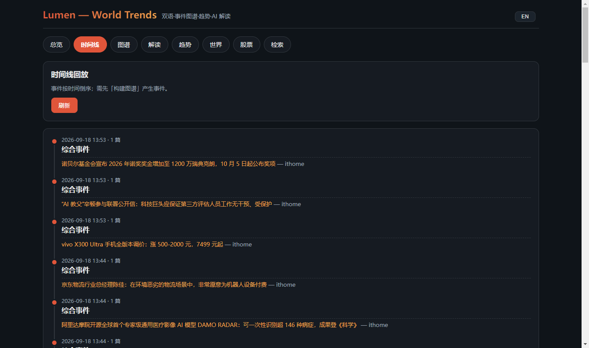

把聚类出的事件按时间倒序组织成可回看的时间线，每条事件列出标题 + 来源（IT之家 / 36氪 / BBC / Guardian / NYT），点击关联文章即可跳读原文；先在「总览」跑一次「构建图谱」即可产生事件。

### 图谱 Tab — 实体节点 + 事件节点 + 共现边

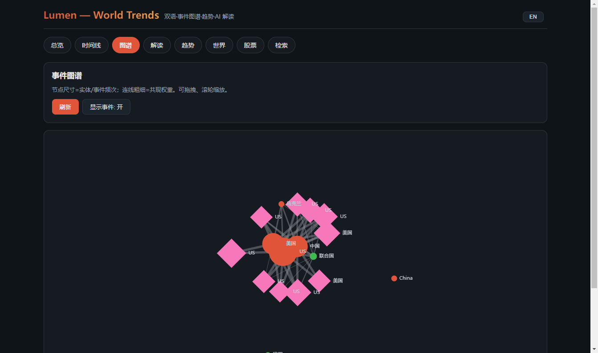

力导向图：圆点 = 实体（按频次着色与大小），菱形 = 事件，连线粗细 = 共现权重。可拖拽节点、滚轮缩放；顶部「显示事件」按钮一键切换事件层可见性，把世界的关系网一眼摊开。

### 检索 Tab — 本地全文检索

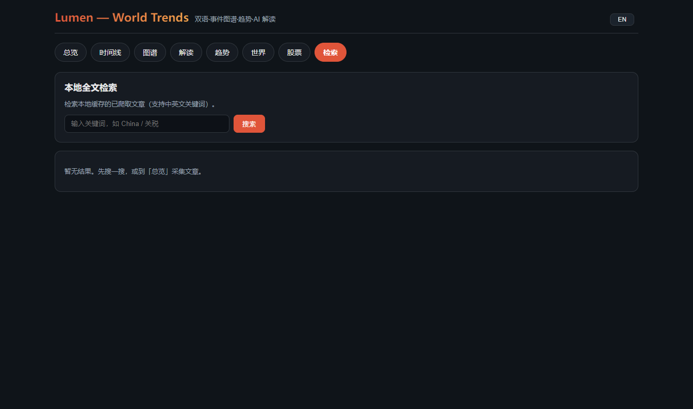

跨中英文关键词检索已抓文章，结果全部来自本地 SQLite（`sql.js`），离线可用；空结果时会提示「先搜一搜，或到「总览」采集文章」。

### 智能体 Tab — 多智能体趋势判断

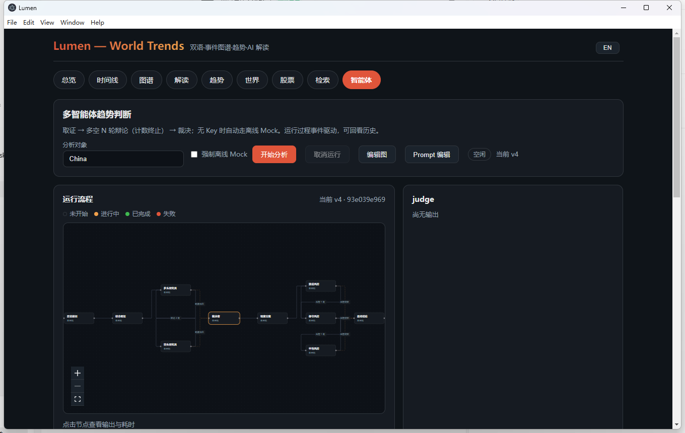

空闲态的真实默认图（v4）：memory → evidence → bull ⇄ bear（计数终止）→ judge → planner → 三方风控（aggressive / conservative / neutral 串行轮转）→ final。节点四态（未开始 / 进行中 / 已完成 / 失败）由事件流 `node.started` / `node.completed` / `node.failed` 驱动。

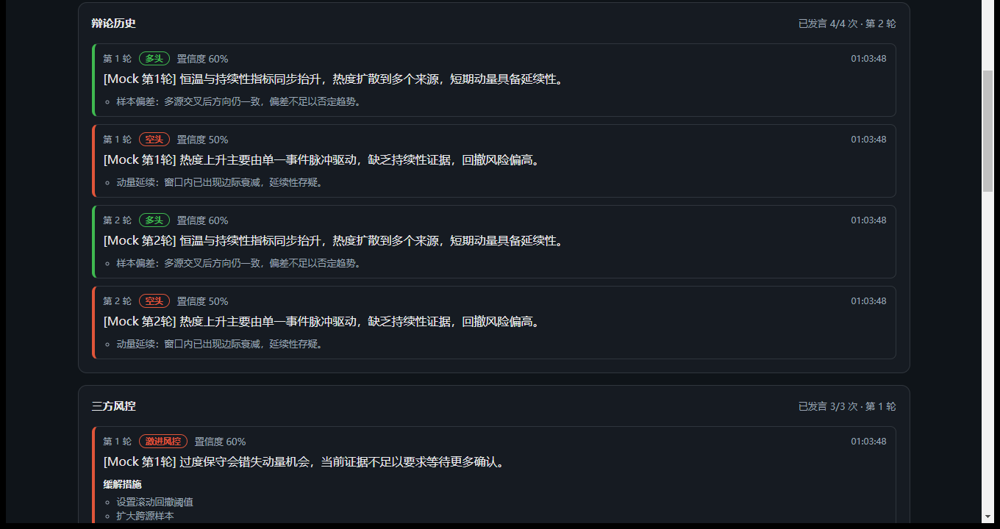

辩论历史按轮次递增展示多头 / 空头发言（含置信度与**该节点尝试的开始时间**，跨天自动补日期）；运行中与历史回放都能看到时间。

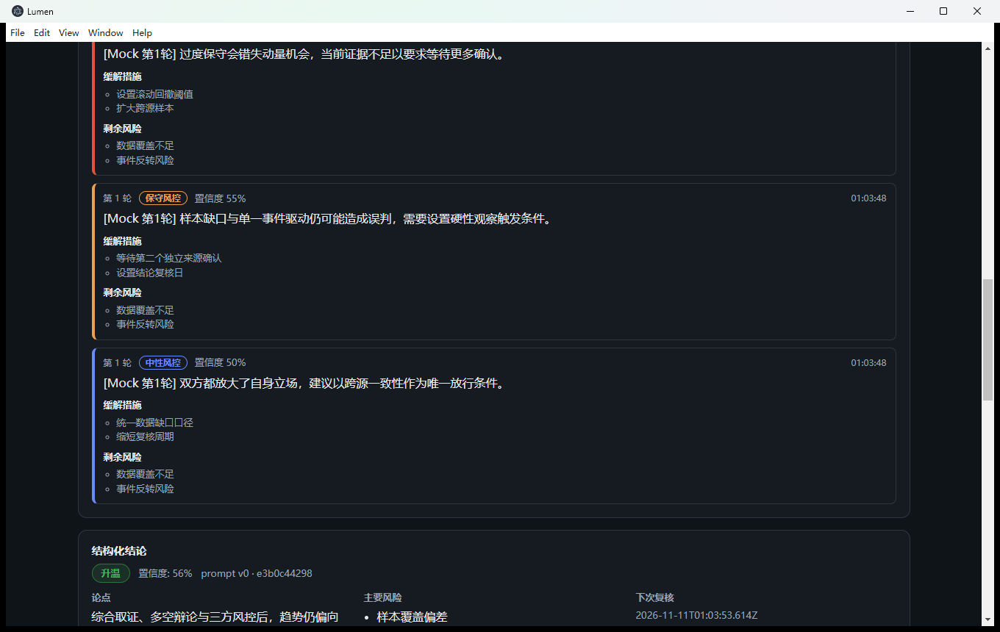

三方风控依次挑战结论（同样带发言时间），下方是结构化结论（评级 / 置信度 / 论点 / 主要风险 / 下次复核）。

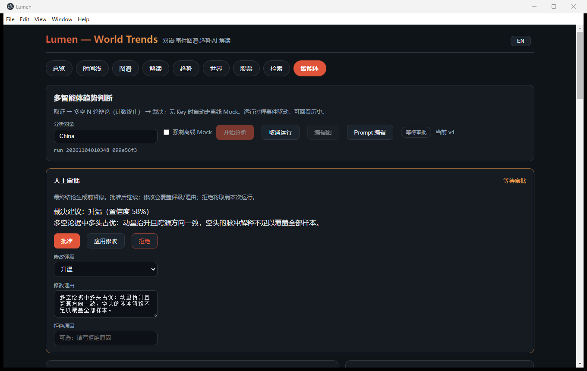

结论落地前挂起等待人工审批：展示裁决建议（评级 / 置信度）、批准 / 应用修改 / 拒绝三种出口，修改会覆盖评级与理由，拒绝会取消本次运行。

## 架构

```
可视化层 (React + Vite + ECharts)          ← Electron IPC（非 HTTP）→
主进程 (Electron Main / Node/TS)
   ├─ 采集 collector (rss / html 适配器)
   ├─ 图谱 graph (entity/event/edge + 聚类)
  ├─ 趋势 trends (时间序列 / 动量 / 热力)
  ├─ 股票 stocks (行情抓取 / 解析 / K线)
  ├─ 因果 causal (规则链构建 + 跨链合并 + AI 断言)
   ├─ 导出 export (快照 Markdown/JSON)
   ├─ 智能体 agent (图编译 / 运行 / 审批 / checkpoint / 记忆结算)
   └─ AI ai (ARK / Mock 可插拔 provider)
数据层: SQLite (sql.js)  →  %APPDATA%\lumen-world-trends\lumen.db
```

单向流水线：`采集 → 标准化去重 → 图谱入库 → 趋势 → 因果链/全局叙事 + AI 解读 → IPC → 展示`
智能体旁路：`本地文章/热点 → 取证 → 辩论 → 裁决 → 风控 → 观察方案 → 人工审批 → 结论 + 记忆结算`

## 技术栈

| 层 | 选型 |
|---|---|
| 桌面壳 | Electron |
| 前端 | React + Vite + TypeScript |
| 图表 | ECharts |
| 采集 | axios / cheerio / rss-parser |
| 存储 | sql.js（SQLite WASM，零原生编译） |
| 测试 | vitest（全夹具，不发真实网络）+ Playwright（Electron E2E） |
| AI | OpenAI 兼容（火山方舟 ARK / Mock） |
| 智能体 | @langchain/langgraph（StateGraph / interrupt）+ sql.js checkpoint |

## 环境要求

- Node.js ≥ 18（建议 20+）
- 本机 CMake 无关：依赖无原生编译，通常无需 VS 构建工具

## 安装与运行

```bash
# 1) 安装依赖
npm install

# 2) 开发模式（Vite + Electron，会弹桌面窗口）
npm run dev

# 3) 生产构建
npm run build

# 4) 运行测试
npm test
```

> 提示：国内网络下载 Electron 二进制如果不畅，可先设置镜像源：
> ```powershell
> $env:ELECTRON_MIRROR="https://npmmirror.com/mirrors/electron/"
> npm install
> ```

## 看板使用（开箱）

启动后顶部有 7 个 Tab（均读本地缓存，离线可用）：

- **总览**：指标卡（文章/实体/事件/边/今日新增）+ 今日热点 chips + 引擎与调度状态 + 操作按钮
  - **采集策略**：启用的新闻源勾选开关 + 自动调度开/关 + 间隔分钟，保存即生效（`settings:get` / `settings:update`）
  - `手动采集`：抓取当前启用的源（`collector:manualRun`）
  - `构建图谱`：对最新文章抽实体/聚类/建边（`graph:build`）
- **趋势**：top 话题热度折线 + **大盘与热点联动**（选指数，双 Y 轴叠加收盘价与热度；`topics:list` + `stocks:history`）
- **世界**：国家热点榜单 + 点击查看国家详情（关联话题/文章）+ 2-4 国热度对比折线 + 地图**按日回放**（播放/暂停/滑块）+ **国家/大洲双维度** + **全球市场冷暖**条（9 大指数当日涨跌；`countries:detail` / `countries:series` / `world:timeline` / `stocks:list`）
- **股票**：自选股报价表（名称/代码/最新价/涨跌/涨跌幅，红涨绿跌；可添加/移除代码，`stocks:watch` / `stocks:add` / `stocks:remove`）+ 点击行看 K 线（**日K/周K/月K** 切换 + 成交量副图 + 缩放，`stocks:history`），带「刷新行情」、5 分钟自动刷新与本地缓存（`stocks:list` / `stocks:refresh`）
  - **分组**：顶部 chip 切分组（默认/可新增/重命名/删除，最后剩 1 组与「默认」不可删保护），`stocks:groups:*`
  - **排序**：默认/名称/最新价/涨跌/涨跌幅一键切换
  - **财务指标**：PE / PB / 总市值 / 换手率 / 振幅 / 量比（按钮显隐）
  - **价格预警**：行内 🔔 弹窗新增预警（涨破价 / 跌破价 / 涨幅> / 跌幅>），命中触发系统通知（同日去重），`stocks:alerts:*`
- **数据源扩展**（M23）：新增 6 路中文热点（微博热搜 / 知乎热榜 / 头条热榜 / 百度热搜 / B站热门 / 抖音热门），复用 `collector:manualRun` 与自动调度接入；热度数值结构化入 `article.hot_score`，新文章自动走图谱 → 趋势 → 因果链 → 解读链路。
- **检索**：本地全文搜索已抓文章（`search:fulltext`）
- **时间线**：事件按时间倒序回放，含关联文章（`timeline:replay`）
- **图谱**：实体节点 + 共现边 + 可开关的事件节点（`graph:query`）
- **解读**：AI 因果解读 / 周报生成 + 历史记录（`insights:generate` / `insights:weekly` / `insights:list`）
  - **全局叙事**：自动合并跨实体链，点击查看整条叙事；可一键生成 **AI 摘要** 与 **反事实推演**（`causality:narratives` / `causality:summarize` / `causality:counterfactual`）
  - **因果链**：输入实体名（如 China / 关税）生成事件链，可开/关 AI 断言，历史可回看（`causality:generate` / `causality:list` / `causality:chain`）
  - **三步引导**：无数据时顶部出现新手指引，可直接「去采集 / 去建图」
  - **导出快照**：一键导出 Markdown/JSON 快照（趋势 + 解读 + 因果链 + 全局叙事，系统保存对话框）（`export:snapshot`）
- **智能体**：多智能体趋势判断（`agent:*`）
  - 选择分析对象 → 「开始分析」跑取证 → 辩论 → 裁决 → 风控 → 观察方案；`final` 前弹出人工审批（批准 / 应用修改 / 拒绝）
  - 运行流程图为节点四态（未开始 / 进行中 / 已完成 / 失败），点节点看输出与耗时；辩论/风控发言逐条显示时间
  - 「编辑图 / 编辑 prompt」可改节点参数、条件边与角色 system prompt；有未保存改动时不允许开跑
  - 进程中断或审批挂起后可「继续运行」；「记忆与结算」展示历史教训与命中率，可手动结算到期记录

## 多智能体趋势分析（智能体 Tab）

### 它做了什么

一次 run 把「本地数据 → 可审计结论」拆成多个智能体节点，所有阶段都通过事件流（`run.started` / `node.*` / `debate.turn` / `risk.turn` / `route.taken` / `run.interrupted` / `run.completed`）实时推给渲染层：

| 阶段 | 节点 | 产出 |
|---|---|---|
| 记忆注入 | `memory` | 只注入 `asOf` 之前已结算的历史教训（`agent.memory.hint`） |
| 取证 | `evidence` | 从本地文章/热点聚合热度、情绪、地缘、结构四个维度的信号与数据缺口 |
| 多空辩论 | `bull` ⇄ `bear` | 交替发言，按 `settings.maxDebateRounds` 计数终止；judge 拿到完整历史 |
| 裁决 | `judge` | `FinalDecision`（评级 / 置信度 / 论点 / 主要风险 / 下次复核） |
| 三方风控 | `risk_aggressive` → `risk_conservative` → `risk_neutral` | 三方依次挑战结论并给缓解措施与剩余风险 |
| 观察方案 | `planner` | `ObservationPlan`（watch / alert / escalate / dismiss + 触发条件） |
| 人工审批 | `final` | 挂起等待批准 / 修改 / 拒绝，批准后才生成终态结论 |
| 记忆结算 | `agent:memory:settle` | 到期记录按真实行情/热度结算成 hit / miss / inconclusive，数据不足标 `insufficient` |

辩论与风控的每条发言都会显示**该节点那次尝试的开始时间**（`HH:MM:SS`，跨天自动补 `MM-DD`）；运行中由 `debate.turn` / `risk.turn` 事件携带，历史回放由 `agent_node_result.started_at` 补齐，两边同源，不额外存列。

### 图编辑与 prompt 编辑的边界

- **能改**：节点 `label`、节点参数（`topN` / `windowDays` / `lookbackDays` / `maxLessons` / `maxRounds` / `maxTriggers` / `dimension`）、条件边（新增 / 删除 / 改条件与目标）、角色 system prompt（取证 / 多头 / 空头 / 裁决 / 风控 / 观察方案 / 终审）。
- **不能改**：节点集合本身（memory 最多 1 个、bull/bear/judge/final 各恰好 1 个、风控三节点必须齐全、启用风控时必须保留 planner），以及不允许自环、重复边、悬空边、非法轮次流转。
- **护栏**：
  - 保存时服务端 `validateGraphSpec` 全量校验，失败返回 `E_VALIDATION` / `E_GRAPH_INVALID` 并把问题定位到具体 `nodeId` / `edgeId`。
  - 运行绑定 `graphVersion + graphDigest`；编辑器有未保存改动时渲染层直接拦截开跑，避免「跑旧图」。
  - prompt 只能改 system 文本：占位符白名单 `{{subject.key}}` / `{{subject.label}}` / `{{asOf}}` / `{{round}}` / `{{memory.lessons}}` / `{{evidence.summary}}`（字符串替换，不做模板求值），单角色上限 800 字符，渲染后超过 1200 字符硬截断。

### 断点续跑与审批恢复

两种中断都能恢复，但**都必须手动点「继续运行」**，不会自动重启：

- **审批挂起**：`final` 节点 `interrupt()` 前把最小状态写进 `agent_run.suspend_json`；进程重启后仍可 `agent:runs:resume` 续跑，已完成节点不重跑。
- **进程中断**：运行中 checkpoint 写入 `agent_run_checkpoint` / `agent_run_checkpoint_write`（sql.js 表，节流批量 export）；重启后 `agent:runs:resumeCheckpoint` 从 checkpoint 继续。
- **恢复条件**：图 `digest` 与 prompt 版本必须与运行时一致，否则 `E_RESUME_STALE_GRAPH` / `E_RESUME_STALE_PROMPT`；checkpoint 缺失或损坏返回 `E_RESUME_NO_CHECKPOINT` / `E_PROCESS_RESTART`，并把 run 降级为 `failed`，不会崩溃。
- 终态（completed / failed / canceled）会**删除 checkpoint**，所以不能再事后恢复调试。

### Mock 与真实 ARK

```powershell
# 默认：未设置 ARK_API_KEY → MockProvider（离线、规则化 JSON，全链路可跑）
npm run dev

# 真实 ARK
$env:ARK_API_KEY = "<你的 ARK API Key>"
$env:ARK_BASE_URL = "https://ark.cn-beijing.volces.com/api/v3"  # 可选
$env:ARK_MODEL = "ep-xxxxxxxx | doubao-seed-1-6-250615"        # 可选
npm run dev
```

- UI 上勾选「强制离线 Mock」可让本次 run 无视 Key 走 Mock（`forceMock`），适合演示与排障。
- 其他相关环境变量：`LUMEN_MOCK_DELAY_MS`（Mock 每步延迟，上限 2000ms，仅测试用）、`LUMEN_PERSIST_INTERVAL_MS`（sql.js 批量落盘间隔）、`LUMEN_CHECKPOINT_FLUSH=immediate`（checkpoint 立即写，默认节流）。

### 数据与本地存储

- 单文件 SQLite（`sql.js` WASM，无原生编译）：`%APPDATA%\lumen-world-trends\lumen.db`，整库 export 落盘。
- schema 版本 **16**（`meta.schema_version`），本能力相关表：`agent_graph` / `agent_prompt_pack` / `agent_run` / `agent_run_event` / `agent_node_result` / `agent_decision` / `agent_memory` / `agent_run_checkpoint` / `agent_run_checkpoint_write`。
- 事件先落库再推送（`agent_run_event` 按 `seq` 单调递增），`agent:runs:events` 支持 `afterSeq` 增量补拉，断线/重启后可无缝续看。

## 启用真实 AI（火山方舟 ARK）

默认无 `ARK_API_KEY` 时走 **Mock**（离线兜底，返回占位解读/规则因果链）。配置真实 ARK：

```powershell
# PowerShell
$env:ARK_API_KEY = "<你的 ARK API Key>"
$env:ARK_BASE_URL = "https://ark.cn-beijing.volces.com/api/v3"  # 可选
$env:ARK_MODEL = "ep-xxxxxxxx | doubao-seed-1-6-250615"        # 可选
npm run dev
```

```bash
# macOS / Linux
export ARK_API_KEY="<你的 ARK API Key>"
export ARK_MODEL="ep-xxxx"   # 可选
npm run dev
```

- 鉴权：`Authorization: Bearer <ARK_API_KEY>`
- 端点：`{ARK_BASE_URL}/chat/completions`
- 支持传入模型 id 或推理接入点 `ep-*`

## 命令与脚本

| 命令 | 作用 |
|---|---|
| `npm run dev` | 开发运行（Vite + Electron） |
| `npm run build` | 生产构建（renderer + electron main + 拷贝 preload） |
| `npm run build:main` | 仅构建 electron 主进程 |
| `npm test` | 运行全部 vitest 测试（夹具，不发网络） |
| `npx tsc -p tsconfig.json --noEmit` | 类型检查 |
| `npm run e2e` | 构建后用 Playwright 驱动 Electron 真实点击跑 6 个智能体场景（导航/重启回看/编辑器校验/拦截旧图/跨进程恢复/流式 token） |
| `$env:LUMEN_SMOKE=1; npx electron .` | 冒烟自检：加载后打印引擎状态并退出，成功输出 `LUMEN_SMOKE_OK` |
| `npm run capture:shots` | 一键捕获 8 个 Tab 的 PNG 到 `images/`（截图工具脚本，详见下方「开发工具：截图捕获」） |

开发辅助环境变量（非必须）：

- `LUMEN_SMOKE=1`：自动加载后打印引擎状态并退出（冒烟自检）
- `LUMEN_INTERVAL_MINUTES`：自动调度间隔兜底值（分钟，默认 30；已在 UI「采集策略」配置后以 UI 为准）
- `STOCK_REFRESH_MINUTES`：股票行情自动刷新间隔（分钟，默认 5）
- `LUMEN_DEBUG=1`：打印渲染层 DOM/console 便于排查白屏
- `LUMEN_CAPTURE=1`：配合 `capture:shots` 启用截图模式（脚本已自动设，**一般不用手设**）
- `LUMEN_CAPTURE_DIR`：自定义截图输出目录（默认 `images/`）
- `LUMEN_CHECKPOINT_FLUSH=immediate`：智能体 checkpoint 每次写入立即落盘（默认节流，测试/排障用）
- `LUMEN_PERSIST_INTERVAL_MS`：sql.js 批量持久化间隔（毫秒）
- `LUMEN_MOCK_DELAY_MS`：MockProvider 每步延迟（毫秒，上限 2000，仅测试用）

## 开发工具：截图捕获

> 用于给 README / 文档 / 发布稿生成 8 个 Tab 的 PNG。

```bash
npm run capture:shots
```

- **做什么**：先 `npm run build`，再以 `LUMEN_CAPTURE=1` 启动 Electron；窗口加载完成后，主进程自动遍历 8 个 nav-btn → `executeJavaScript` 切 Tab → 等 2600ms 让图表/地图渲染 → `webContents.capturePage()` 截图 → 写 `<tab>.png`，完成后自动 `app.quit()`。
- **输出目录**：默认 `images/`（仓库根）；可设 `LUMEN_CAPTURE_DIR` 改路径，目录会自动 `mkdir -p`。
- **顺序**：固定为 `dashboard / timeline / graph / insights / trends / world / stocks / search`，与上方「截图一览」章节顺序一致。
- **Git 策略**：截图脚本入源码，**PNG 产物随文档一起入库**（`images/` 已被 git 跟踪；刷新截图后记得一并提交）。
- **CI**：本工具是开发辅助，**不在 CI 自动跑**（需要桌面 Electron 环境）；只在发版前手跑一次刷新文档。
- **注意事项**：
  - 必须先 `npm run build`，因为脚本依赖 `dist/` + `dist-electron/` 产物。
  - 每个 Tab 等 2600ms 是为图表/地图就绪的保守值；如果图表特别慢，可适当调长（修改 `electron/main/capture.ts` 的 `sleep(2600)`）。
  - 暂只截可视区；如果某个 Tab 很长（如时间线/图谱），未来可改为整页截图（`capturePage()` 默认是可视区，需结合 `webContents.setVisualZoomLevelLimits` 等扩展）。

## 项目结构

```
lumen/
  electron/main/         # 主进程
    collectors/          # 采集适配器 (rss/html) + 源注册表
    extract/             # 实体词典 (gazetteer)
    graph/               # 聚类 / 关系 / 图谱仓储 / buildGraph
    trends/              # 趋势引擎 / 热力 / 实体时序
    causal/              # 因果链构建 (规则) + 跨链合并 (merge) + AI 断言 + 仓储
    export/              # 快照导出 (Markdown/JSON)
    world/               # 国家详情 / 多国对比 / 按日回放时间线（countries:* / world:timeline）
    stocks/              # 行情 watchlist / 腾讯&Mock provider（stocks:*）
    agent/               # 多智能体：图编译/校验、节点实现、运行时、仓储、checkpoint、记忆结算
    db/                  # sql.js 连接 / 迁移 / 持久化 + 股票缓存/自选股
    ai/                  # provider(ARK/Mock) + 解读器
    dash/                # 总览汇总（dashboard:today）
    db/                  # sql.js 连接 / 迁移 / 持久化
    ipc/                 # IPC handlers
    index.ts             # 入口
  src/                   # 渲染层 (React)
    components/          # 总览 / 时间线 / 图谱 / 解读 / 趋势 / 世界 / 检索 / 智能体
    components/agent/    # 智能体画布、图编辑器、prompt 编辑器
    world/               # 世界地图 GeoJSON 归一化 + 大洲聚合（geo / regions）
    stocks/              # 市场×趋势叠线辅助（overlay）
    i18n/                # 中/英字典 + Provider(hook)
    hooks/               # useInvoke / useEngineStatus / useAgentRun / useGraphEditor
  resources/             # 世界 GeoJSON（110m，生成物）
  shared/                # 主/渲染共享类型与契约
  tests/                 # vitest 夹具测试
  e2e/                   # Playwright Electron 真实点击 E2E
  docs/superpowers/      # specs + 里程碑计划 + 交付记录
```

## 测试

- 单元/集成测试全用 **fixture**（RSS/HTML 字符串、内存 SQLite），**不依赖真实网络**。
- `npm test` 覆盖：契约、数据层、采集适配（含中文 RSS）、图谱聚类/仓储、趋势引擎、总览汇总、国家详情/对比、世界按日时间线、大洲聚合映射、股票解析/缓存/自选股、市场×趋势叠线对齐（fixture+Mock，不发网络）、i18n 字典、AI provider/解读（含周报）、insight 仓储、因果链（规则构建/AI 断言/仓储）、跨链合并/全局叙事、叙事 AI 摘要/反事实推演、采集策略设置（持久化/过滤/钳制）、快照导出（Markdown/JSON）、检索。
- 智能体专项：图校验/条件边、节点实现、运行时事件序列与 `afterSeq` 补拉、审批三出口、token 流式、checkpoint 节流与恢复、跨进程重启、记忆结算、辩论/风控发言时间戳（运行中事件 + 历史回放）。
- `npm run e2e` 用 Playwright 驱动真实 Electron 窗口跑 6 个场景；不替代人工验收。
- 真实抓取/真实 ARK 由你在应用里点按钮触发，不在 CI 中验证（本机网络对 GitHub 等不稳）。

## 局限与路线图

- ✓ **中文热点站（微博/知乎等）**（M23）：已用 Electron BrowserWindow 复用 Chromium 接入 6 源（微博 / 知乎 / 头条 / 百度 / B站 / 抖音），新增 `json-api` / `browser` 两种适配器，热度结构化入 `article.hot_score`。
- ✓ **热度排序 UI**（M24）：trends 加 sort/window/style 控件；dashboard Top 10 widget；world 国家详情 Top 5；4 种 HotBadge 风格。
- **世界热力地图**：已实现 choropleth（110m 粒度）+ 按日回放 + 国家/大洲双维度（大洲映射为精选列表，缺省落入「其他」，可在 `src/world/regions.ts` 扩充）；更细行政区可换用 50m GeoJSON 重生成（`scripts/gen-world-geo.mjs`），回放可扩展为周/月档与动画插帧。
- **实体识别**：当前为词典 + 句法匹配；可升级为本地 NLP 或交给 AI 做更细抽取与上下位关系。
- **图谱**：关系类型 v1 仅 `co-occurrence`；真正的因果/包含关系交给 AI 解读阶段。
- **因果链**：v1 基于共享实体的时间相邻锚点，AI 断言可选；v2 支持跨实体合并成全局叙事 + AI 摘要 + 反事实推演；下一步可做时序因果/影响量化。
- **导出快照**：v1 为 Markdown/JSON 全文导出；可扩展为图表 PNG、订阅式自动归档。
- **股票行情**：行情来自腾讯公开接口（第三方免费源，可能限流/变更）；已支持自选股增删、日/周/月 K 与 5 分钟自动刷新；**M22 新增**自选分组、多种排序、6 项财务指标（PE/PB/总市值/换手率/振幅/量比）与价格预警（涨破/跌破/涨幅阈值 + 系统通知）；下一步可做 K 线技术指标叠加（MA/MACD）或自选导入/导出。
- **AI**：解读聚焦最热话题（≤400 字）；可按需扩展周报/月报样式与模型切换。
- **多智能体（默认图）**：多空辩论与三方风控都是**串行轮转**（bull ⇄ bear、aggressive → conservative → neutral），不是真并行；LangGraph 的并行写只体现在 checkpoint 的 pending writes 排序，不会同时发起多次模型调用。
- **断点续跑**：终态（completed / failed / canceled）会删除 checkpoint，**不能事后恢复调试**；恢复只在 UI 手动点「继续运行」触发，没有自动重启；图 digest 或 prompt 版本变化后旧 run 不可恢复（`E_RESUME_STALE_GRAPH` / `E_RESUME_STALE_PROMPT`）。
- **在线 smoke**：`npm run e2e` 与 `LUMEN_SMOKE=1` 都走 Mock，**未覆盖真实 ARK 的在线链路**；真实模型需手动配 `ARK_API_KEY` 验收。
- **智能体画布**：长页面或运行态下偶发节点未绘制（DOM 已存在但画布空白），切走页签再回来可恢复；属已知渲染问题，尚未定位。
- **分析对象（`subject`）**：只影响 prompt 文案与记忆结算的匹配键（`entity.name` 精确匹配），取证始终读本地全量文章/热点，**不做关键词过滤**——把 `China` 改成 `United States` 不会改变取证语料。

## IPC 契约一览

主/渲染经 `shared/contracts.ts` 统一定义渠道：`engine:status` `dashboard:today` `collector:manualRun` `graph:build` `topics:list` `insights:generate` `insights:list` `insights:weekly` `causality:list` `causality:generate` `causality:chain` `causality:narratives` `causality:summarize` `causality:counterfactual` `export:snapshot` `settings:get` `settings:update` `search:fulltext` `graph:query` `timeline:replay` `countries:detail` `countries:series` `world:timeline` `stocks:list` `stocks:refresh` `stocks:history` `stocks:watch` `stocks:add` `stocks:remove` `stocks:groups:list` `stocks:groups:create` `stocks:groups:rename` `stocks:groups:remove` `stocks:groups:setWatch` `stocks:alerts:list` `stocks:alerts:add` `stocks:alerts:remove` `stocks:alerts:toggle`；智能体：`agent:graph` `agent:run` `agent:resume` `agent:runs:resume` `agent:runs:resumeCheckpoint` `agent:cancel` `agent:runs:list` `agent:runs:get` `agent:runs:events` `agent:graphs:list` `agent:graphs:get` `agent:graphs:save` `agent:graphs:delete` `agent:graphs:restoreDefault` `agent:memory:list` `agent:memory:settle` `agent:prompts:get` `agent:prompts:save`。

## 授权说明

本仓库专注“爬取公开新闻 → 结构化 → 洞察”的工程质量；请遵守各新闻源的使用条款与所在法律法规，控制抓取频率，尊重版权。
